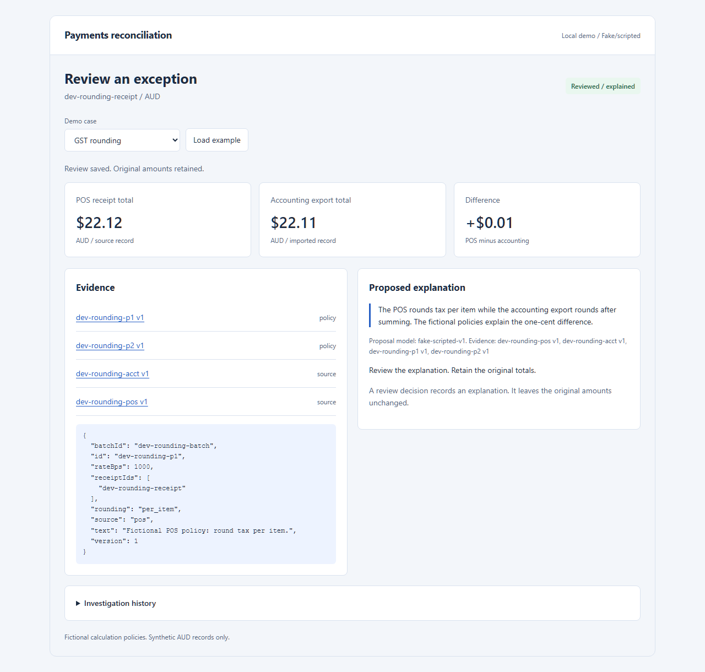

# Payments reconciliation assistant

A small TypeScript and LangGraph demonstration that investigates a synthetic rounding discrepancy, cites evidence, pauses for review and resumes after a process restart.

**Live model: Claude Sonnet 5.5.** Claude chooses evidence/calculation tools and submits an explanation through the persisted LangGraph workflow. Exact calculations, source preservation and proposal-specific approval remain enforced by the application. The [dated live evaluation](docs/live-report.md) records measured results and limitations.

An additional fake/scripted mode keeps automated tests reproducible and ordinary CI free of paid calls. No AWS deployment or production use is claimed.



The screenshot shows scripted regression mode. Live mode displays the Claude model ID, and saved proposals identify the model that produced them.

On 27 October 2026, the live study passed **36 of 36 case runs** using 108 Claude calls, with **USD 0.888652** in reported token charges. The rules-only baseline also matched every category. These results describe a small synthetic sample; see the [full report](docs/live-report.md) for failures, budget accounting and evidence limits.

## The example

Two fictional tax-exclusive items cost AUD 10.05 each. Under the fixture's explicit 10% tax and half-up rules:

| Calculation convention           |      Tax |     Gross |
| -------------------------------- | -------: | --------: |
| Round tax separately per item    | AUD 2.02 | AUD 22.12 |
| Sum the subtotal, then round tax | AUD 2.01 | AUD 22.11 |

The one-cent difference is explainable when the applicable fictional policies and item records are available. Accepting that explanation records a review decision. Both source totals remain intact. Missing evidence, conflicting facts and unexplained mismatches remain open.

These are invented calculation policies, not tax advice or a claim about real GST compliance. The compared exports are POS and accounting records; a payment provider is not depicted as recalculating sales tax.

## Run locally on Windows

Use Node **24.22.1**, the version pinned in `.node-version`.

```powershell
npm.cmd ci
npm.cmd run build
Copy-Item .env.example .env
```

Edit `.env` locally and paste your personal Claude API key after `ANTHROPIC_API_KEY=`. The file is ignored by Git. Start the real-model demonstration:

```powershell
npm.cmd start -- --mode anthropic --data-dir data/claude-demo
```

Open the printed loopback address, normally `http://127.0.0.1:4313`. Select an example and choose **Load example**. The four examples cover rounding, missing policy, an unexplained mismatch and an exact match. The reviewer identity is explicitly `demo-reviewer`.

Claude mode needs an Anthropic API key and credit. It binds only to loopback. Runtime SQLite files are written under ignored `data/`. The UI identifies both the runtime model and the model that produced each saved proposal. To run without credentials or paid calls:

```powershell
npm.cmd start -- --mode fake --data-dir data/scripted-demo --port 4313
```

Claude calls share a persistent application budget ledger at `data/llm-budget.sqlite`, capped at USD 5 under the dated configured prices. Every request reserves its conservative maximum before transport. Valid token usage settles the charge; missing/uncertain usage retains the reservation. This can stop work before USD 5 of measured usage. Preserve this ledger across demo/evaluation runs; changing `--data-dir` does not reset it. The ledger bounds this application's calls, not other activity on your provider account. The live report distinguishes measured charges and unresolved reservations.

If npm encounters an enterprise certificate-chain error on Windows, Node can use the machine's trusted system certificates for that process. Do not disable TLS verification:

```powershell
$env:NODE_USE_SYSTEM_CA = '1'
npm.cmd ci
```

## Verify

```powershell
npx.cmd playwright install chromium
npm.cmd run check
npm.cmd run evaluate:offline
```

`check` builds and typechecks the app, runs the Node suite and runs browser checks. Actual child processes test persisted review and four crash boundaries. The offline evaluator uses twelve frozen cases and compares outcomes with independent expected answers and a rules-only baseline. Its JSON/Markdown reports are written to ignored `results/`.

See the [dated offline report](docs/offline-report.md), [restart demonstration](docs/demo.md), [technical design](docs/design.md) and [evaluation method](docs/evaluation.md). [GitHub Actions](https://github.com/DmitryLyubaev/payments-reconciliation-assistant/actions/workflows/ci.yml) runs the offline checks on Windows. The workflow uses synthetic data and scripted responses, with no paid model calls or deployment.

To explicitly run the paid evaluation with the configured local key and the same persistent budget:

```powershell
npm.cmd run evaluate:live -- --split dev --passes 1
npm.cmd run evaluate:live -- --split heldout --passes 3
```

Inspect the existing report before rerunning; each new evaluation can incur additional charges within the ledger cap. Local summaries and runtime files stay under ignored `results/` and `data/`. The live report states which evidence was retained, including the original study's transcript-retention limit.

## What the implementation demonstrates

- BigInt/rational money arithmetic, explicit rounding points and string minor units at persistence/API boundaries.
- Immutable source versions, deterministic evidence snapshots, idempotent imports and stale-approval rejection.
- Constrained evidence tools and a bounded, checkpointed LangGraph investigation.
- Proposal-specific review, durable decision intents and one terminal outcome under replay.
- A small same-origin review interface with text-only handling of imported content.
- Frozen development/held-out cases, a real Claude adapter and measured separation of model proposals from validated workflow outcomes.

The supported rounding domain is deliberately small. Ordinary deterministic rules can diagnose these cases, so this project does not claim that an AI agent is necessary or better. A later real-model study must measure any added value, latency and cost rather than assume it.

## Limits and next steps

The app supports synthetic AUD, positive tax-exclusive items, one fictional tax rate and a single local reviewer. It has no ledger, money movement, provider integration, real authentication, cloud availability guarantee or arbitrary upload endpoint. Unmatched counterparts show an unavailable difference instead of inventing zero.

The real-model adapter uses `claude-sonnet-5-5`, low effort, `between_tools` thinking and automatic tool choice. Model/prompt/request configuration is bound to persisted investigations. Incompatible recovery cannot silently invoke a different model. A later AWS deployment needs its own architecture and operational evidence. Nothing in this repository establishes commercial cloud experience or production AI adoption.
