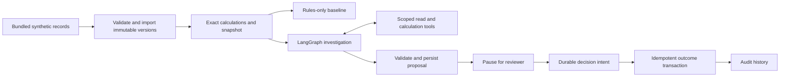

# Local workflow design

This demonstration reconciles two independently invented exports for the same synthetic receipt. Its useful output is a supported explanation or an explicit unresolved exception, with the original financial records preserved.

## Money and evidence

Money is stored and transported as canonical integer minor-unit strings. Arithmetic uses BigInt/rational values with half-up rounding only at the selected policy boundary. Inputs and persisted outputs have an 18-digit limit. Recorded totals that contradict their own subtotal/tax are retained as contradictory evidence rather than rewritten.

Schemas distinguish absent item detail from malformed input. Evidence snapshots include source versions, policy versions and coverage. A new source or policy version changes the active snapshot. Original versions remain immutable. A missing counterpart makes the recorded difference unavailable.

The reason categories are `matched`, `explained_rounding`, `insufficient_evidence`, `contradictory_evidence` and `unexplained_mismatch`. A matching recorded total bypasses the model and does not imply that missing item-level evidence has been verified.

A rounding explanation requires equal source subtotals and matching item IDs/net amounts, independent of item order. Item IDs identify the same item across the synthetic source copies. Each recorded tax/gross must also match its applicable rounding policy. Independently valid calculations on different items remain unexplained, even when the net subtotals agree.

## Investigation

The graph exposes only `listEvidence`, `getEvidence` and `compareRounding`. Calls are scoped to one immutable snapshot. Tools cannot browse, execute SQL, alter records or approve anything. Replies are bounded and completed read/calculation results are saved for replay. Imported notes cannot turn themselves into policies.

One investigation permits six model attempts, eight tool calls, 60 seconds and one transient retry inside those bounds. A hung adapter is aborted at the remaining deadline. A crash with an uncheckpointed started attempt leaves an explicit interrupted failure rather than silently repeating a potentially billable call.

The default test adapter reads an authored script. Explicit Claude mode uses the Anthropic Messages API with the same scoped tools and a final submitProposal function. Signed assistant blocks are preserved in append-only history. Model, prompt and request-schema/settings identity are persisted; live investigations cannot reuse scripted proposals. Proposed structured amounts and references are checked against authoritative arithmetic. Structural validation cannot prove that every narrative sentence is grounded; the dated live evaluation records the observed model behavior and its limits.

A separate persistent SQLite ledger reserves each paid call before transport at the full context/output maximum under the dated configured prices. Valid usage settles token charges. Failed, interrupted or malformed receipts retain their maximum reservation. Budget state survives process restarts and disposable evaluation databases; there is no automatic replenishment. This is an application guard, rather than an account-wide provider billing control.

## Persistence and approval

The application owns `app.sqlite`; LangGraph owns `checkpoints.sqlite`. The graph persists a proposal and interrupts for reviewer input. Review applies to an immutable proposal ID/version and its evidence digest. Resuming uses the saved thread rather than rerunning an investigation.

Review submission commits a decision intent first. An application transaction rechecks the current snapshot, writes one outcome and appends one terminal audit event. The graph then checkpoints. On restart, the runner resumes pending work and reuses an existing application outcome if the graph checkpoint was interrupted.

Acceptance produces `reviewed_explained`. Rejection, unresolved acknowledgement and invalidated decisions leave the exception `open_unresolved`. New evidence never inherits an old approval. The graph passes its expected proposal ID into intent application, preventing an intent from being applied on behalf of another proposal.

## Local interface and boundaries

One Node process serves built static assets and a small HTTP API on loopback. A random per-launch session token, Host/Origin checks and same-origin responses protect mutations. The identity `demo-reviewer` is a local demonstration identity, not authenticated proof of a person's identity.

The browser shows source totals, the difference, evidence, a proposal and audit history. Imported/model text is rendered as text. Only bundled development cases are selectable; held-out gold and arbitrary filesystem paths are not served. The browser reloads its session token after a restart while application state remains in SQLite.

Startup returns the thread registered by the workflow rather than reconstructing a script/configuration key in HTTP. The browser saves that thread and supplies it on review reads. Reads without an explicit thread use the current model configuration; explicitly selected older threads remain available within the same receipt and current evidence snapshot. Each decision targets the displayed proposal ID/version/digest.

Review refreshes are bound to the current selection and request. Evidence responses also require the latest evidence request and a reference in the current snapshot. Late responses from another receipt are discarded.

A custom Node state machine was considered. LangGraph was selected to demonstrate a framework's checkpoint/interruption semantics. SQLite and a single process keep this milestone reproducible; they do not predetermine a later cloud architecture.
